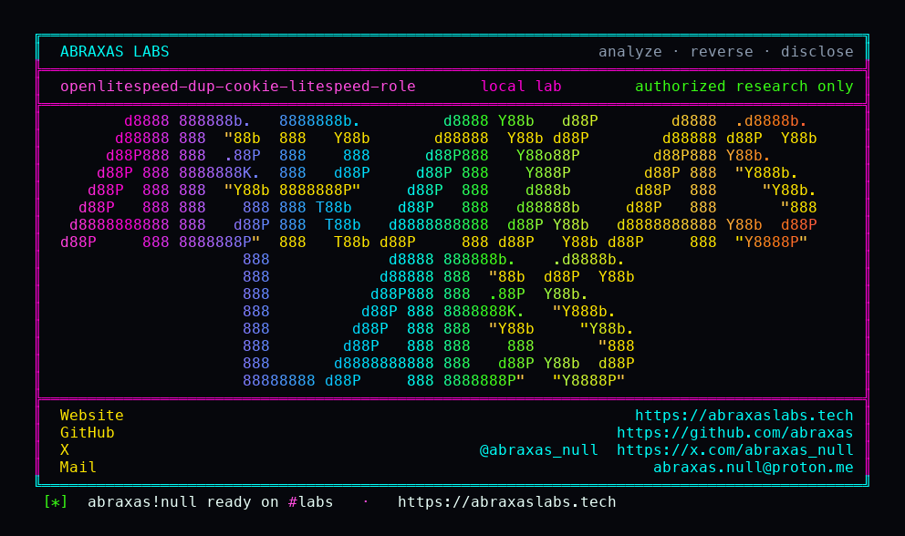

<p align="center">
  
</p>

<p align="center">
  <a href="https://abraxaslabs.tech"><strong>abraxaslabs.tech</strong></a>
  &nbsp;·&nbsp;
  <a href="https://github.com/abraxas">github.com/abraxas</a>
  &nbsp;·&nbsp;
  <a href="https://x.com/abraxas_null">@abraxas_null</a>
  &nbsp;·&nbsp;
  <a href="mailto:abraxas.null@proton.me">abraxas.null@proton.me</a>
  &nbsp;·&nbsp;
  <a href="https://github.com/abraxas/openlitespeed-dup-cookie-litespeed-role">openlitespeed-dup-cookie-litespeed-role</a>
</p>

# openlitespeed-dup-cookie-litespeed-role

**Class:** Privilege leftover
**Reach:** Remote

**OpenLiteSpeed** 1.9.3 (`edbe7f7db12577e905291955a6d416200942fb8b`) still 403s a single `Cookie: litespeed_role=` (the 1.8.2.1 block). HTTP/1 duplicate `Cookie` is not 400. Host / Content-Length / Transfer-Encoding / Authorization duplicates are. The second Cookie line is demoted to unknown, the `litespeed_role=` scan never runs, `IS_BL_COOKIE` stays unset, and lsphp still receives `HTTP_COOKIE`. LSAPI last-wins: PHP `$_SERVER['HTTP_COOKIE']` is the second line.

HTTP/2 already scans every Cookie header. This leftover is HTTP/1.1. The lab did not populate `$_COOKIE['litespeed_role']`. Not WordPress ATO. Not RCE.

| | |
|---|---|
| ID | no CVE yet |
| Class | **Privilege leftover** (1.8.2.1 `litespeed_role=` 403 skip) |
| Reach | **Remote** (unauthenticated HTTP/1.1) |
| CWE | [CWE-693](https://cwe.mitre.org/data/definitions/693.html), [CWE-436](https://cwe.mitre.org/data/definitions/436.html) |
| CVSS | **High: 7.5** `CVSS:3.1/AV:N/AC:L/PR:N/UI:N/S:U/C:N/I:H/A:N` |
| Product | [OpenLiteSpeed](https://github.com/litespeedtech/openlitespeed) |
| Affected | 1.9.3 (`edbe7f7`); HTTP/1.1 plus lsphp |
| Auth | none |
| License | [GNU Affero GPL v3.0](LICENSE) |
| Lab | `127.0.0.1:18750` only |

## What an attacker can do

Send two Cookie headers on one HTTP/1.1 request. The first is harmless. The second carries `litespeed_role=`. OpenLiteSpeed 403s that name on a single Cookie header and on every HTTP/2 Cookie header. Duplicate HTTP/1 Cookie skips the 403. lsphp still sees the role in `HTTP_COOKIE`.

Apps that parse `HTTP_COOKIE` get the value the 1.8.2.1 control was meant to keep off the worker. Apps that only read `$_COOKIE['litespeed_role']` did not see it in this lab.

## How I found it

Twenty source hunts of v1.9.3 after Caddy and lighttpd. The 1.8.2.1 block is `memmem(..., "litespeed_role=", 15)` on the first common Cookie. Duplicate Cookie is not in the 400 list.

Wrong turns: treating urllib as able to send two Cookie headers (it merges them); expecting official docker to listen on 8088 (the Hub image is 80); expecting `$_COOKIE` to follow `HTTP_COOKIE` last-wins (LSAPI filled the cookie table from the first header).

## Lab

```bash
cd lab
./run.sh
```

Image `litespeedtech/openlitespeed:1.9.3-lsphp84`. Oracle `lab/www/cookie.php`. Raw HTTP/1.1 sockets. Bind loopback.

```text
SUCCESS openlitespeed-dup-cookie-litespeed-role single-cookie=403 dummy=200 dup-cookie=200 php-sees-role=yes how=php-http-cookie OLS-DUP-COOKIE-LITESPEED-ROLE-WITNESS
```

## The fix

Scan every HTTP/1 Cookie header the way HTTP/2 already does, or 400 duplicate Cookie the way Host is 400.

## References

- [github.com/litespeedtech/openlitespeed](https://github.com/litespeedtech/openlitespeed) tag [v1.9.3](https://github.com/litespeedtech/openlitespeed/releases/tag/v1.9.3) (`edbe7f7db12577e905291955a6d416200942fb8b`)
- `src/http/httpreq.cpp` duplicate common headers, first-Cookie `litespeed_role=` scan, `IS_BL_COOKIE` 403
- `src/http/httpcgitool.cpp` unknown header export as `HTTP_COOKIE`
- 1.8.2.1 block `litespeed_role` cookie
